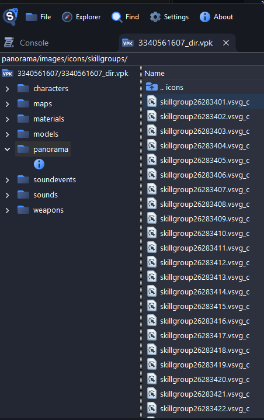

<a name="readme-top"></a>

<div align="center">
  <h1 align="center">KitsuneLab©</h1>
  <h3 align="center">K4-LevelRanks</h3>
  <a align="center">A comprehensive ranking and statistics system for Counter-Strike 2. Features point-based progression, detailed player statistics, weapon tracking, and LVL Ranks database compatibility.</a>
</div>

<p align="center">
  
  
  
  
</p>

# Important notice!
> [!IMPORTANT]  
> [K4ryuu](https://github.com/K4ryuu) is the creator of this plugin.<br>
> Since he is no longer maintaining his CS2 plugins, I forked some of them and maintain them ONLY FOR BUG FIXES!

---

## Table of Contents

- [Features](#features)
- [Requirements](#requirements)
- [Installation](#installation)
- [Commands](#commands)
- [Configuration](#configuration)
  - [`config.json`](#configjson) — database, point gating, scoreboard, point system, VIP
  - [`points.json`](#pointsjson) — point value per event
  - [`ranks.json`](#ranksjson) — the rank ladder
  - [`commands.json`](#commandsjson) — command names and aliases
  - [`modules.json`](#modulesjson) — optional feature toggles
- [Database setup](#database-setup)
  - [Separate ranks per server](#separate-ranks-per-server)
  - [Supported databases](#supported-databases)
  - [Database permissions](#database-permissions)
- [Upgrading](#upgrading)
- [License](#license)

---

## Features

- **Point-based ranking** — around 50 scoring events, every one of them tunable, feeding an
  18-rank ladder you can rename, recolour and re-threshold.
- **Dynamic multipliers** — optionally scale kill rewards and death penalties by the point gap,
  so beating a stronger player pays more than farming a weaker one.
- **Scoreboard integration** — rank in the clan tag, score synced to points, and fake competitive
  rank icons (Premier, Competitive, Wingman, Danger Zone, or your own mapping).
- **Detailed statistics** — kills, deaths, assists, headshots, K/D, accuracy, round and match
  records, plus playtime with optional point rewards.
- **Optional per-weapon and per-hitbox tracking** — kills, shots, hits, accuracy and damage per
  weapon; damage by body part, compatible with ExStats Hits.
- **VIP multiplier** granted by permission flags.
- **LVL Ranks compatible** — point it at an existing LVL Ranks database and it picks up where
  that left off, with no migration step.
- **Developer API** (`K4LevelRanks.Api.v1`) so other plugins can read points and ranks.

### Point Events

| Category          | Events                                                                          |
| ----------------- | ------------------------------------------------------------------------------- |
| **Combat**        | Kill, Death, Headshot, Assist, Flash Assist, Team Kill, Team Assist, Suicide     |
| **Special Kills** | No-scope, Through Smoke, Blind Kill, Wallbang, Long Distance                    |
| **Weapon Kills**  | Knife, Taser, Grenade, Molotov/Incendiary, Impact (Flash/Smoke/Decoy)           |
| **Killstreaks**   | Double Kill → God Like (11 tiers)                                               |
| **Objectives**    | Bomb Plant/Defuse/Explode/Pickup/Drop, Hostage Rescue/Rescue All/Hurt/Kill      |
| **Round**         | Round Win/Lose, MVP                                                             |
| **Playtime**      | Configurable points per X minutes                                               |

---

## Requirements

- [**SwiftlyS2**](https://github.com/swiftly-solution/swiftlys2) — the Counter-Strike 2 server
  plugin framework.
- **A database** — MySQL/MariaDB, PostgreSQL or SQLite. See
  [Supported databases](#supported-databases) for picking one.

<p align="right">(<a href="#readme-top">back to top</a>)</p>

---

## Installation

1. Install [SwiftlyS2](https://github.com/swiftly-solution/swiftlys2) on your server
2. Configure your database connection in SwiftlyS2's `database.jsonc` (MySQL, PostgreSQL, or SQLite)
3. [Download the latest release](https://github.com/shmitzas/K4-LevelRanks-Upkeep/releases/latest)
4. Extract to your server's `swiftlys2/plugins/` directory
5. Configure the plugin files in `swiftlys2/configs/plugins/k4.levelranks/`
6. Restart your server - database tables will be created automatically

<p align="right">(<a href="#readme-top">back to top</a>)</p>

---

## Commands

Names and aliases below are the stock values — all of them are renameable in
[`commands.json`](#commandsjson).

### Player Commands

| Command           | Aliases                     | Description                   |
| ----------------- | --------------------------- | ----------------------------- |
| `!rank`           | `!myrank`                   | Open main rank menu           |
| `!ranks`          | `!ranklist`                 | View all available ranks      |
| `!top`            | `!ranktop`, `!toplist`      | View top players by points    |
| `!mytime`         | `!playtime`, `!servertime`  | View your own playtime        |
| `!ttop`           | `!timetop`, `!toptime`      | View top players by playtime  |
| `!stats`          | `!mystats`, `!stat`         | View detailed statistics      |
| `!weaponstats`    | -                           | View weapon statistics        |
| `!hitstats`       | -                           | View hit/body part statistics |
| `!settings`       | `!options`                  | Player settings menu          |
| `!resetmyrank`    | -                           | Reset your own rank           |
| `!togglepointmsg` | -                           | Toggle point messages         |

`!weaponstats` and `!hitstats` do nothing while their
[module](#modulesjson) is disabled.

### Admin Commands

| Command                           | Permission            | Description               |
| --------------------------------- | --------------------- | ------------------------- |
| `!setpoints <target> <amount>`    | `k4-levelranks.admin` | Set player's points       |
| `!givepoints <target> <amount>`   | `k4-levelranks.admin` | Give points to player     |
| `!removepoints <target> <amount>` | `k4-levelranks.admin` | Remove points from player |

The permission is fixed — the `Permission` field in `commands.json` is not read.

<p align="right">(<a href="#readme-top">back to top</a>)</p>

---

## Configuration

All five files live in `swiftlys2/configs/plugins/k4.levelranks/`. Each one is wrapped in its
own root section and the plugin reads nothing outside it, so a key placed at the top level of
the file is silently ignored:

| File            | Root section      | Contents                                                     |
| --------------- | ----------------- | ------------------------------------------------------------ |
| `config.json`   | `K4Ranks`         | Database, rank gating, scoreboard, point system, VIP          |
| `points.json`   | `K4RanksPoints`   | Point value per event                                         |
| `ranks.json`    | `K4RanksRanks`    | The rank ladder                                               |
| `commands.json` | `K4RanksCommands` | Command names and aliases                                     |
| `modules.json`  | `K4RanksModules`  | Optional feature toggles                                      |

```jsonc
{
  "K4Ranks": {
    "Database": { "Connection": "host" },
    "Rank": { "MinPlayers": 4 }
    // ...
  }
}
```

All five are watched for changes. Values are re-read live where that is meaningful; the ones
that only take effect on restart are called out below.

### `config.json`

Database, point gating, scoreboard and VIP settings.

#### `Database`

| Option                | Description                                                                                                                                            | Default  |
| --------------------- | ------------------------------------------------------------------------------------------------------------------------------------------------------ | -------- |
| `Connection`          | Connection name from SwiftlyS2's `database.jsonc`                                                                                                        | `"host"` |
| `TablePrefix`         | Prefix for this server's tables — `"awp"` gives `awp_lvl_base`. See [Separate ranks per server](#separate-ranks-per-server)                                         | `""`     |
| `TableSuffix`         | Suffix for the same tables — `"awp"` gives `lvl_base_awp`. Can be combined with `TablePrefix`                                                             | `""`     |
| `TablePrefixPosition` | **Removed in v1.5.0.** Still read so that an upgrade which leaves it set alongside a prefix stops at startup instead of quietly switching tables — delete the key | `""`     |
| `PurgeDays`           | Delete player records untouched for this many days. `0` never purges                                                                                     | `30`     |

The whole section takes effect on server restart.

#### `Rank`

| Option          | Description                                                                                     | Default |
| --------------- | ----------------------------------------------------------------------------------------------- | ------- |
| `StartPoints`   | Points a new player starts with, and the value `!resetmyrank` restores                            | `0`     |
| `MinPlayers`    | Human players that must be connected before any points are awarded. Bots are never counted        | `4`     |
| `WarmupPoints`  | Award points during warmup                                                                        | `false` |
| `PointsForBots` | Award points for killing and damaging bots                                                        | `false` |
| `FFAMode`       | Treat every kill as an enemy kill — disables the team-kill and team-assist penalties entirely      | `false` |

#### `Scoreboard`

| Option              | Description                                                                                                                                                      | Default |
| ------------------- | ---------------------------------------------------------------------------------------------------------------------------------------------------------------- | ------- |
| `Clantags`          | Write the player's rank `Tag` into their clan tag                                                                                                                  | `true`  |
| `ScoreSync`         | Mirror the player's points into their scoreboard score                                                                                                             | `false` |
| `UseRanks`          | Show fake competitive rank icons. Needs `FollowCS2ServerGuidelines` set to `false` in SwiftlyS2's [core config](https://swiftlys2.net/docs/resources/core-config)   | `true`  |
| `RankMode`          | Which icon set to drive: `0` = [Custom](#custom-rank-icons-rankmode-0), `1` = Premier (shows the point count itself), `2` = Competitive (icons 1-18), `3` = Wingman (1-18), `4` = Danger Zone (1-15) | `1`     |
| `CustomRankBase`    | `RankMode 0` only — icon number your **lowest** rank maps to; every rank above it counts up by one                                                                 | `0`     |
| `CustomRankMax`     | `RankMode 0` only — rank position above which every higher rank shares a single icon. Keep it at or above the number of ranks in `ranks.json`                      | `18`    |
| `CustomRankMargin`  | `RankMode 0` only — subtracted from every mapped icon number. Leave at `0` unless you want to start part-way into the range                                        | `0`     |
| `RevealAllInterval` | Seconds between periodic re-broadcasts of the message that lets clients see *other* players' rank icons rather than only their own and their friends'                 | `3.0`   |

That message is already sent on every player connect, map load and round start, so
`RevealAllInterval` is a safety net — `0` turns the timer off and is normally fine. Raise it
only if players report rank icons disappearing mid-round.

#### Custom rank icons (`RankMode` 0)

Modes 1-4 reuse Valve's own icons. `RankMode` 0 instead maps your ranks onto icon numbers you
supply yourself, which is how you get rank images that are not Valve's.

The icons come from a workshop addon. Inside its VPK each one is a `skillgroup<number>.vsvg`
under `panorama/images/icons/skillgroups/`, and **those numbers are what you configure here**
— so open the addon and look at them before filling anything in:



The addon above ships `skillgroup26283401` through `skillgroup26283500`, so the lowest rank
points at `26283401` and there is room for 100 ranks:

```json
"Scoreboard": {
  "Clantags": false,
  "ScoreSync": false,
  "UseRanks": true,
  "RankMode": 0,
  "CustomRankBase": 26283401,
  "CustomRankMax": 100,
  "CustomRankMargin": 0,
  "RevealAllInterval": 5
},
```

From that base it simply counts up the ladder in `ranks.json`:

| Rank in `ranks.json` | Icon used        |
| -------------------- | ---------------- |
| 1st (lowest)         | `skillgroup26283401` |
| 2nd                  | `skillgroup26283402` |
| 18th                 | `skillgroup26283418` |
| 100th                | `skillgroup26283500` |

`CustomRankMax` is a rank position, not an icon number: ranks beyond it all collapse onto one
icon, so keep it at or above however many ranks you actually define. `100` here matches the
100 icons the addon provides.

Clients only render these icons if they have the addon, so it has to be one your server makes
them download. Without it they see no rank icon at all.

#### `Points`

| Option                      | Description                                                                             | Default |
| --------------------------- | ----------------------------------------------------------------------------------------- | ------- |
| `RoundEndSummary`           | Print one summary at round end instead of a chat message per action                        | `false` |
| `ShowPlayerNames`           | Include the killer/victim name in point messages. Has no effect while `RoundEndSummary` is on | `false` |
| `KillstreakResetOnRoundEnd` | Clear killstreaks at round end rather than waiting for the next round start                | `false` |
| `DynamicDeathPoints`        | Scale the death penalty by the point gap — [see below](#dynamic-kill-and-death-points)     | `false` |
| `DynamicDeathPointsMin`     | Death multiplier against the strongest possible attacker (expected `0`-`1`)                | `0.5`   |
| `DynamicDeathPointsMax`     | Death multiplier against the weakest possible attacker (expected `1`+)                     | `3.0`   |
| `DynamicKillPoints`         | Scale the kill reward by the point gap — [see below](#dynamic-kill-and-death-points)       | `false` |
| `DynamicKillPointsMin`      | Kill multiplier against the weakest possible victim (expected `0`-`1`)                     | `0.5`   |
| `DynamicKillPointsMax`      | Kill multiplier against the strongest possible victim (expected `1`+)                      | `3.0`   |

#### `Vip`

| Option       | Description                                                                                         | Default                 |
| ------------ | ----------------------------------------------------------------------------------------------------- | ----------------------- |
| `Multiplier` | Multiplier applied to point **gains** only; penalties are never scaled. `1.0` or lower disables VIP    | `1.25`                  |
| `Flags`      | Permission flags that grant VIP — holding any one is enough. An empty list disables VIP                | `["k4-levelranks.vip"]` |

#### Dynamic kill and death points

Both sides are **off by default** - set `DynamicDeathPoints` and/or `DynamicKillPoints`
to `true` to enable them.

Dying to a much weaker player hurts more; dying to a much stronger one hurts less.
Killing a much stronger player pays more; killing a much weaker one pays less. Both
sides read the same point gap and differ only in the bounds they use, so either can
be tuned or turned off on its own.

An even matchup always scores exactly the configured `Kill` / `Death` value. With the
stock `8` / `-5` and `0.5` / `3.0` bounds:

| Matchup                      | Attacker gets | Victim loses |
| ---------------------------- | ------------- | ------------ |
| Equal points                 | `8`           | `5`          |
| 900 points kills 1000        | `10`          | `6`          |
| 50 points kills 10000        | `24`          | `15`         |
| 10000 points kills 50        | `4`           | `3`          |

Bots and players whose record has not loaded are not scaled - there is no counterparty
to compare against, so the configured value applies as-is.

### `points.json`

Every entry is the points awarded for that event unless marked otherwise; negatives are
penalties. **Set any value to `0` to disable it.**

Three entries are thresholds rather than point values and are flagged in place.

#### Combat

| Option            | Description                                                                                           | Default |
| ----------------- | ------------------------------------------------------------------------------------------------------- | ------- |
| `Kill`            | Killing an enemy. Gated by `PointsForBots` when the victim is a bot                                      | `8`     |
| `Death`           | Dying to anyone but yourself or a teammate. Applies even when the killer is a bot                        | `-5`    |
| `Headshot`        | Bonus stacked on `Kill` when the kill was a headshot                                                     | `5`     |
| `Assist`          | Damage assist on an enemy                                                                                | `5`     |
| `AssistFlash`     | Flash assist on an enemy                                                                                 | `7`     |
| `TeamKill`        | Killing a teammate. Never fires while `FFAMode` is on; the victim loses nothing                          | `-10`   |
| `TeamAssist`      | Damage assist on a teammate                                                                              | `-5`    |
| `TeamAssistFlash` | Flash assist on a teammate                                                                               | `-7`    |
| `Suicide`         | Dying with no attacker, or to yourself                                                                   | `-5`    |

#### Special Kills

Bonuses stacked on top of `Kill`, so they only pay out on a kill that scored in the first place.

| Option             | Description                                                                              | Default |
| ------------------ | ------------------------------------------------------------------------------------------ | ------- |
| `NoScope`          | Sniper kill taken without scoping                                                           | `15`    |
| `Thrusmoke`        | Shot passed through a smoke grenade                                                         | `15`    |
| `BlindKill`        | Attacker was flashed at the moment of the kill                                              | `5`     |
| `Penetrated`       | Shot penetrated at least one surface (wallbang)                                             | `3`     |
| `LongDistanceKill` | Paid when the kill distance reaches `LongDistance`                                          | `8`     |
| `LongDistance`     | **Distance threshold in metres, not points** — the range `LongDistanceKill` requires        | `30`    |

#### Weapon Kills

Also stacked on `Kill`, and matched on the killing weapon.

| Option        | Description                                 | Default |
| ------------- | --------------------------------------------- | ------- |
| `KnifeKill`   | Any knife                                     | `15`    |
| `TaserKill`   | Zeus x27                                      | `20`    |
| `GrenadeKill` | HE grenade                                    | `30`    |
| `InfernoKill` | Molotov or incendiary grenade                 | `30`    |
| `ImpactKill`  | Flashbang, smoke or decoy hitting the victim  | `100`   |

#### Round

| Option      | Description                            | Default |
| ----------- | ---------------------------------------- | ------- |
| `RoundWin`  | Awarded to the winning team's players    | `5`     |
| `RoundLose` | Awarded to the losing team's players     | `-2`    |
| `MVP`       | Round MVP                                | `10`    |

#### Bomb

| Option             | Description                                                    | Default |
| ------------------ | ---------------------------------------------------------------- | ------- |
| `BombPlant`        | Planting the bomb                                                 | `10`    |
| `BombDefuse`       | Defusing the bomb                                                 | `10`    |
| `BombDefuseOthers` | Awarded to every CT other than the defuser                        | `3`     |
| `BombExploded`     | Awarded to the planter when the bomb detonates                    | `10`    |
| `BombPickup`       | Picking the bomb up                                               | `2`     |
| `BombDrop`         | Dropping the bomb                                                 | `-2`    |

#### Hostage

| Option             | Description                             | Default |
| ------------------ | ----------------------------------------- | ------- |
| `HostageRescue`    | Rescuing a hostage                        | `15`    |
| `HostageRescueAll` | Bonus for rescuing every hostage          | `10`    |
| `HostageHurt`      | Damaging a hostage                        | `-2`    |
| `HostageKill`      | Killing a hostage                         | `-20`   |

#### Playtime

| Option            | Description                                                                 | Default |
| ----------------- | ----------------------------------------------------------------------------- | ------- |
| `PlaytimePoints`  | Points granted each interval. `0` disables playtime rewards                   | `10`    |
| `PlaytimeMinutes` | **Interval in minutes, not points.** `0` or lower also disables the reward    | `5.0`   |

#### Killstreaks

Each tier pays once, at that kill in the streak. Only kills that scored a `Kill` count, so
team kills and (unless `PointsForBots` is on) bot kills do not advance a streak.

A streak survives the attacker's own death — it is cleared at round start, optionally at round
end via `KillstreakResetOnRoundEnd`, and by the `SecondsBetweenKills` gap below.

| Option                | Description                                                                                                        | Default |
| --------------------- | -------------------------------------------------------------------------------------------------------------------- | ------- |
| `SecondsBetweenKills` | **Seconds, not points.** A longer gap between kills restarts the streak. `0` means the streak never times out          | `0`     |
| `DoubleKill`          | 2nd kill                                                                                                              | `5`     |
| `TripleKill`          | 3rd kill                                                                                                              | `10`    |
| `Domination`          | 4th kill                                                                                                              | `15`    |
| `Rampage`             | 5th kill                                                                                                              | `20`    |
| `MegaKill`            | 6th kill                                                                                                              | `25`    |
| `Ownage`              | 7th kill                                                                                                              | `30`    |
| `UltraKill`           | 8th kill                                                                                                              | `35`    |
| `KillingSpree`        | 9th kill                                                                                                              | `40`    |
| `MonsterKill`         | 10th kill                                                                                                             | `45`    |
| `Unstoppable`         | 11th kill                                                                                                             | `50`    |
| `GodLike`             | 12th kill, and every kill after it                                                                                    | `60`    |

### `ranks.json`

One entry per rank. Order in the file does not matter — entries are sorted by `Points` at
load, and a second entry sharing a `Name` with an earlier one is dropped with a warning.

There is no unranked state: a player below the lowest `Points` still holds the lowest rank,
so that entry doubles as the default.

| Field    | Description                                                                                          | Example       |
| -------- | ------------------------------------------------------------------------------------------------------ | ------------- |
| `Name`   | Display name, used in chat and menus                                                                   | `"Silver I"`  |
| `Tag`    | Written **verbatim** into the clan tag when `Scoreboard.Clantags` is on — add your own brackets if wanted | `"S1"`        |
| `Color`  | Chat colour tag for rank-up messages                                                                   | `"[gray]"`    |
| `Hex`    | Colour used in the `!rank` / `!top` menus, which render HTML rather than chat colours                  | `"#808080"`   |
| `Points` | Minimum points required to hold this rank                                                              | `0`           |

```json
{
  "K4RanksRanks": {
    "Ranks": [
      { "Name": "Silver I", "Tag": "S1", "Color": "[gray]", "Hex": "#808080", "Points": 0 },
      { "Name": "Gold Nova I", "Tag": "GN1", "Color": "[gold]", "Hex": "#FFD700", "Points": 1000 },
      { "Name": "Global Elite", "Tag": "GE", "Color": "[red]", "Hex": "#FF0000", "Points": 7500 }
    ]
  }
}
```

The stock ladder ships 18 CS:GO-style ranks from Silver I at `0` to Global Elite at `7500`.
`Color` and `Hex` are independent - a rank needs both set to look right in chat *and* in the menus.

### `commands.json`

Every command is renameable. Each entry takes the same three fields:

| Field        | Description                                                                               |
| ------------ | ------------------------------------------------------------------------------------------- |
| `Command`    | Primary name. Leave it empty to not register the command (and its aliases) at all            |
| `Aliases`    | Extra names for the same command; empty entries are skipped                                  |
| `Permission` | **Currently ignored.** The three admin commands are gated on a fixed `k4-levelranks.admin`   |

```json
{
  "K4RanksCommands": {
    "Top": { "Command": "top", "Aliases": ["ranktop", "toplist"], "Permission": "" }
  }
}
```

The keys are `Rank`, `Ranks`, `Top`, `ResetMyRank`, `ToggleMessages`, `MyTime`, `TopTime`,
`SetPoints`, `GivePoints`, `RemovePoints`, `Stats`, `WeaponStats`, `HitStats` and `Settings`
— see [Commands](#commands) for the stock names. Changes take effect on server restart.

### `modules.json`

A disabled module creates no table and records nothing. Its entry is hidden from the `!stats`
menu and its command does nothing.

| Module               | Description                                                            | Default |
| -------------------- | ------------------------------------------------------------------------ | ------- |
| `WeaponStatsEnabled` | Per-weapon kills, deaths, headshots, shots, hits and damage              | `true`  |
| `HitStatsEnabled`    | Per-hitgroup damage tracking (ExStats Hits compatible)                   | `true`  |

Takes effect on server restart.

<p align="right">(<a href="#readme-top">back to top</a>)</p>

---

## Database setup

Tables are created and kept up to date automatically on start. The schema is LVL Ranks
compatible, so pointing the plugin at an existing LVL Ranks database picks up where that
left off with no migration step.

| Table               | Contents                                               |
| ------------------- | -------------------------------------------------------- |
| `lvl_base`          | Points, rank and the main statistics                      |
| `lvl_base_settings` | Per-player preferences                                    |
| `lvl_base_weapons`  | Weapon statistics — only when `WeaponStatsEnabled`        |
| `lvl_base_hits`     | Hit statistics — only when `HitStatsEnabled`              |

Stats are written periodically and when a player leaves, so `!top` and `!ttop` can trail
live play by up to a minute.

### Separate ranks per server

By default the table names above are used as-is and every server sharing the database shares
one set of ranks. Set `TablePrefix` and/or `TableSuffix` to give a server its own tables, so
several game modes can share one database instead of needing a database each:

```json
{
  "K4Ranks": {
    "Database": {
      "Connection": "host",
      "TablePrefix": "awp",
      "TableSuffix": ""
    }
  }
}
```

| `TablePrefix` | `TableSuffix` | Tables used                                                                        |
| ------------- | ------------- | ---------------------------------------------------------------------------------- |
| `""`          | `""`          | `lvl_base`, `lvl_base_settings`, `lvl_base_weapons`, `lvl_base_hits`                 |
| `"awp"`       | `""`          | `awp_lvl_base`, `awp_lvl_base_settings`, `awp_lvl_base_weapons`, `awp_lvl_base_hits` |
| `""`          | `"awp"`       | `lvl_base_awp`, `lvl_base_settings_awp`, `lvl_base_weapons_awp`, `lvl_base_hits_awp` |
| `"awp"`       | `"2v2"`       | `awp_lvl_base_2v2`, `awp_lvl_base_settings_2v2`, ...                                 |

- Both can be set at once; neither excludes the other.
- **The separating underscore is added for you**, so `"awp"`, `"awp_"` and `"_awp"` all name
  the same tables. Tidying the value later is therefore a no-op rather than a silent move to
  an empty set of tables.
- Only letters, digits and underscores are allowed; anything else is rejected at startup.
- Changing either value points the server at a different, possibly empty, set of tables.
  Nothing is renamed or moved for you — rename the tables yourself if you want to keep the data.
- Takes effect on server restart.

### Supported databases

| Database        | Status  | Notes                                      |
| --------------- | ------- | ------------------------------------------ |
| MySQL / MariaDB | ✅ Full | Recommended for multi-server setups        |
| PostgreSQL      | ✅ Full | Alternative for existing Postgres setups   |
| SQLite          | ✅ Full | Perfect for single-server, no setup needed |

### Database permissions

Creating and updating the tables needs `CREATE`, `ALTER` and `INDEX` on top of the usual
`SELECT`, `INSERT`, `UPDATE` and `DELETE`. Shared hosting often grants only the latter.

Without them the plugin still runs, as long as the tables it needs already exist — it logs a
warning that it could not apply schema changes and carries on. Only when a required table is
missing or unreadable does it disable itself, naming the tables so you can either grant the
missing rights or create them by hand.

<p align="right">(<a href="#readme-top">back to top</a>)</p>

---

## Upgrading

### From v1.4.0 or earlier

`TablePrefixPosition` is gone. Use `TablePrefix` for `awp_lvl_base` or `TableSuffix` for
`lvl_base_awp`, then delete the old key — leaving it set alongside a prefix stops the plugin
at startup.

A prefix that did not already end in `_` (`"awp"` used to give `awplvl_base`) now resolves
differently. The plugin logs a warning naming both table names; rename the old tables if you
want to keep that data.

<p align="right">(<a href="#readme-top">back to top</a>)</p>

---

## License

Distributed under the GPL-3.0 License. See [`LICENSE.md`](LICENSE.md) for more information.

<p align="right">(<a href="#readme-top">back to top</a>)</p>
